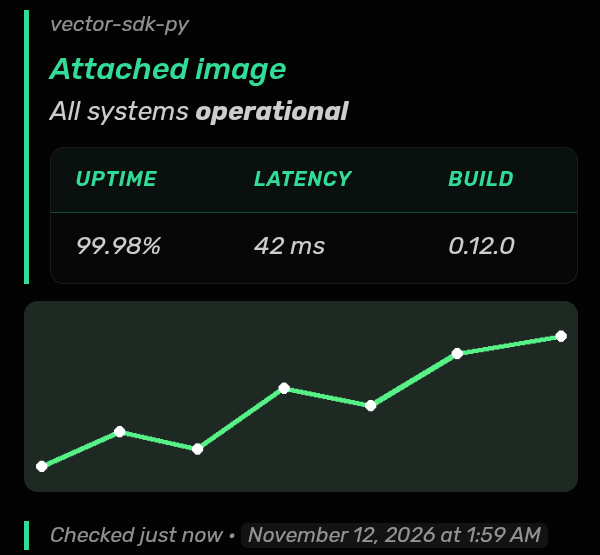
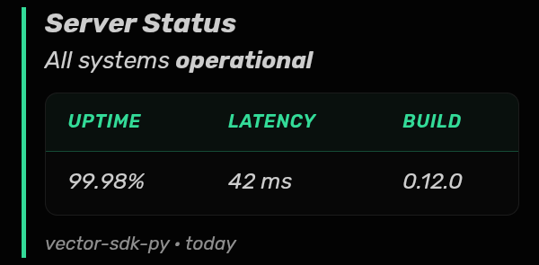

# vector-sdk-py

**A discord.py-style Python library for [Vector](https://vectorapp.io) messenger bots, powered by the official Rust [`vector_sdk`](https://crates.io/crates/vector_sdk).**

If you've written a discord.py bot, you already know this library. It has the same decorators, cogs, `ctx`, checks, cooldowns, converters, `wait_for`, `tasks.loop`, embeds and views. Underneath, every network, crypto and storage call runs in the Rust SDK (compiled into the package with [PyO3](https://pyo3.rs)), so you get its MLS-style Communities, NIP-17 DMs, Mini Apps and voice without writing any Rust.

```python
import os
import vector
from vector.ext import commands

bot = commands.Bot(command_prefix="!")

@bot.event
async def on_ready():
    print(f"Logged in as {bot.user}")

@bot.command()
async def ping(ctx):
    await ctx.reply("pong 🏓")

bot.run(os.environ.get("VECTOR_NSEC"))
```

`!ping` works, and so does Vector's native `/ping`: every command is also published to the bot's
manifest, so it appears in Vector's `/` picker with typed arguments.

---

## Install

```bash
pip install git+https://github.com/lucky-edgelord/vector-sdk-py
```

This compiles the Rust SDK, so you need a Rust toolchain ([rustup.rs](https://rustup.rs)) and `cmake`
(for the Opus voice codec). The first build takes a few minutes, and later installs reuse the cache.
Prebuilt wheels for Linux, macOS and Windows come from the GitHub Actions workflow in
`.github/workflows/ci.yml`. Once they're published to PyPI, it's just `pip install vector-sdk-py`.

Python 3.9+ is supported. One `abi3` wheel covers every Python version on a platform.

### Optional features

Voice and Mini Apps are built by default. Speech-to-text (whisper.cpp), Tor and I2P are opt-in:

```bash
pip install "git+https://github.com/lucky-edgelord/vector-sdk-py" \
    --config-settings=build-args="--features whisper,tor"
```

`vector.Client.features()` tells you what your build has.

### Your bot's key

A Vector identity is a Nostr key. `bot.run(nsec)` logs in with an `nsec1…` key, which plays the role of discord.py's token.

```python
print(vector.generate_nsec())  # mint one and keep it secret
```

`bot.run()` with no key reuses the key stored in `data_dir` (default `./vector-bot-data`), creating one on first run.
Seed phrases work too: `bot.run(mnemonic="word word …")`.

---

## Coming from discord.py

Most bots port by changing the imports:

```diff
- import discord
- from discord.ext import commands, tasks
+ import vector as discord          # or just `import vector`
+ from vector.ext import commands, tasks
```

| discord.py | vector-sdk-py | Notes |
|---|---|---|
| `discord.Client`, `commands.Bot` | `vector.Client`, `commands.Bot` | `command_prefix` defaults to `"/"` |
| `bot.run(token)` | `bot.run(nsec)` | or `run()` to reuse the stored key |
| `Guild` | `Community` (`Guild` is an alias) | `message.guild` / `ctx.guild` work |
| `user.id` | `user.npub` (`id` is an alias) | ids are npubs / 64-char hex |
| `discord.Intents` | accepted, ignored | Vector sends every event |
| `@bot.event`, `@bot.listen()` | same | |
| `@bot.command()`, `@bot.group()`, `hybrid_command` | same | also published as native `/` commands |
| `commands.Cog`, `Cog.listener()`, `load_extension` | same | `async def setup(bot)` |
| checks, `has_permissions`, `cooldown`, `is_owner` | same | `owner_id=` takes an npub |
| converters (`Member`, `Role`, `TextChannel`, `Greedy`, `Range`, `Literal`…) | same | |
| `discord.Embed` | `vector.Embed` | rendered as coloured markdown (below) |
| `discord.ui.View`, `Button`, `Select`, `Modal` | `vector.ui.*` | built from reactions (below) |
| `app_commands.CommandTree` | same | `tree.sync()` is a no-op |
| `tasks.loop` | same | |
| `VoiceChannel.connect()`, `vc.play(FFmpegPCMAudio(...))` | same | plus listening and transcription |
| `message.delete()` | same | your own messages are deleted, others' are hidden (moderation) |
| `delete_after=` | same | also sets a NIP-40 expiry every client honours |
| `ephemeral=True` | sent as a DM | |

### Events

The usual names fire with the usual arguments: `on_ready`, `on_resumed`, `on_connect`, `on_disconnect`, `on_message`,
`on_message_edit(before, after)`, `on_message_delete`, `on_raw_message_delete`, `on_raw_message_edit`,
`on_reaction_add(reaction, user)`, `on_reaction_remove`, `on_raw_reaction_add/remove`, `on_typing(channel, user, when)`,
`on_member_join`, `on_member_remove`, `on_member_update(before, after)`, `on_member_ban(guild, user)`,
`on_member_unban`, `on_guild_join`, `on_guild_remove`, `on_guild_update(before, after)`,
`on_guild_role_create/update/delete`, `on_guild_channel_create/update/delete`, `on_guild_channel_pins_update`,
`on_voice_state_update(member, before, after)`, `on_command`, `on_command_completion`, `on_command_error`, `on_error`.

Vector adds more:

| Event | When |
|---|---|
| `on_community_invite(invite)` | someone invited the bot (`await invite.accept()`), with `invite_policy="manual"` |
| `on_community_change(change)` | any audited Community change (raw form of all the above) |
| `on_member_kick(guild, member)` | a kick (Discord folds this into `on_member_remove`) |
| `on_member_timeout(member, until)` / `on_member_timeout_end(member)` | timeouts |
| `on_member_roles_update(member, added, removed)` / `on_member_nickname_update(member, nick)` | finer-grained member updates |
| `on_overwrite_update(channel, target, overwrite)` | a permission overwrite changed |
| `on_channel_keyed(channel, backfilled)` | the bot got the key for a private channel |
| `on_community_dissolve(guild)` | the owner dissolved the Community |
| `on_xdc_presence(presence)` / `on_xdc_session(session)` | Mini App activity |
| `on_slash_command(name, args, message)` | any native `/command` (raw) |

---

## Commands: prefix and native slash at once

```python
from typing import Literal, Optional

@bot.command()
@commands.describe(temp="the temperature", unit="what it's in")
async def convert(ctx, temp: float, unit: Literal["c", "f"]):
    ...
```

This is published to Vector as `/convert <temp:number> <unit:c|f>`. Type hints map to Vector's argument types:

| Hint | Vector arg | Hint | Vector arg |
|---|---|---|---|
| `str` | text | `bool` | flag |
| `int` | int | `Member` / `User` | user picker |
| `float` | number | `Literal[...]` | choice |
| `*, rest: str` / `*args` / `Greedy[...]` | trailing text | anything else (`Role`, `TextChannel`, custom converters) | text, converted in Python |

Vector checks the types and replies with usage before your code runs. Groups become `/name <subcommand> [args]`.
Commands whose name or signature can't be expressed natively (uppercase names, more than 8 args) stay prefix-only, and a log line says so.

Set a prefix like `"!"` to also accept text commands, or keep the default `"/"` for native-only. Load cogs in `setup_hook`
(as discord.py recommends) so their commands are part of the manifest published at startup.

## Embeds

`vector.Embed` has discord.py's full API (`add_field`, `set_author`, `set_footer`, `set_image`, `to_dict`/`from_dict`…)
and is rendered into Vector's markdown:



The embed above is built from a normal `vector.Embed`. A text-only embed looks like this:



* the body sits in a blockquote, so it gets Vector's solid accent bar down the left
* colours are always Vector's own (mint title); the embed's `colour` is ignored so embeds match the app
* the title is a real heading; with `url=` it links without Vector unfurling a large preview card
* inline fields (up to 3 per row) become one Vector table card inside the quote
* `set_image(url="attachment://chart.png")` with `file=vector.File("chart.png")` sends the image as a real attachment
  right under the body; web image URLs are downloaded and attached the same way (falling back to the link)
* the footer and `timestamp` (`<t:…:f>`, each reader's own timezone) go in a small quote of their own, after the
  image. With an image an embed goes out as separate messages (body, image, footer) rather than using an attachment
  caption, which Vector can drop when a chat reloads. `send` returns the last one, which is where a view's reactions go

## Views, buttons, selects, modals


Vector has no message components, so `vector.ui` builds them from reactions. Each button or option becomes an
emoji reaction the bot adds under the message. Buttons with their own emoji show only the reaction; buttons without one get a letter (🇦 🇧 …) and a short label line. Reacting clicks it, and removing
your reaction clicks it again.

```python
class Confirm(ui.View):
    @ui.button(label="Confirm", emoji="✅", style=ui.ButtonStyle.success)
    async def confirm(self, interaction: vector.Interaction, button: ui.Button):
        await interaction.response.send_message("Done!")
        self.stop()

await ctx.send("Are you sure?", view=Confirm(timeout=60))
```

* Buttons without an emoji get 🇦 🇧 🇨…, and select options get 1️⃣ 2️⃣ 3️⃣….
* `timeout`, `on_timeout`, `interaction_check`, `stop()`, `await view.wait()`, `interaction.response.edit_message()`, and `ephemeral=True` (sent as a DM) all work.
* `ui.Modal` asks its `TextInput`s as a short chat conversation, then calls `on_submit`.
* `ui.Paginator(pages)` pages through text or embeds with ⏮ ◀ ▶ ⏭ ⏹.

## Voice

```python
vc = await voice_channel.connect()
vc.play(vector.FFmpegPCMAudio("song.mp3"), after=lambda e: print("done"))

async for member, pcm in vc.utterances():       # bots can listen, per speaker
    print(member, await transcriber.transcribe(pcm))
```

Audio is 48 kHz mono 16-bit PCM bytes. `vc.say(pcm)`, `vc.hush()`, `vc.listen()`, `vector.Utterances`,
`vector.Transcriber("ggml-base.en.bin")` (whisper build), and `on_voice_state_update` with `self_video` / `self_stream` are all available.
The Rust SDK doesn't support live video for bots, so neither does this library.

## Mini Apps (WebXDC)

```python
@bot.xdc_app("vector-counter")                   # or "*" for any app; @commands.Cog.xdc_app in cogs
async def counter(session: vector.XdcSession):
    async for event in session:                  # data / peer_join / peer_leave
        if event.type == "data":
            await session.send_json({"echo": event.json(), "from": event.verified_sender})
```

`await channel.send_xdc("app.xdc")` shares an app, and `message.xdc.join()` / `.manifest()` work on shared ones.

## Everything else the SDK can do

Communities: `create_community`, `join(invite_url)`, `fetch_invite` (preview), `guild.create_invite(max_age=, label=)`,
`invites()`, `create_role`, `edit_role_positions`, `create_text_channel/voice_channel/forum/category`,
`channel.set_permissions(target, **perms)`, `overwrites`, `permissions_for`, `edit(category=, position=, private=…)`,
`grant_access` for private channels, `pins()` / `message.pin()`, `audit_logs()`, `bans()`, `bulk_ban`,
`contain_raid`, `member.timeout()`, nicknames, icons and banners, relay management (`check_relays`, `move_relays`),
recovery (`refound`, `repair_roster`), `leave()` / `delete()` (dissolve).

Messages: `history()` (pulls older pages from relays automatically), `purge`, `fetch_message`, `edit`, replies,
custom emoji reactions (`subscribe_emoji_pack`), attachments (`await attachment.read()`), link previews, `expires_in`,
`to_bot=` addressing, typing indicators.

Account: `change_presence`, `bot.user.edit(username=, avatar=, about=)`, `block`/`unblock`, `upload_image`, `sync_dms`.

Anything not wrapped is still reachable through `bot.native`, which is the raw Rust bot.

---

## Examples

See [`examples/`](examples): a basic bot, a cogs/extensions bot (moderation, fun with polls and tasks, owner tools),
UI views, a music + transcription bot, a Mini App bot, and `app_commands` on a plain Client.

## Development

```bash
pip install maturin pytest pytest-asyncio
maturin develop --release        # build the Rust extension into your venv
pytest tests                     # the Python layer is tested against a fake native bot
```

Layout: `src/` is the PyO3 binding (`vector._native`, a thin layer over `vector_sdk`), and `python/vector/` is the
discord.py-style API built on top.

## License

MIT. `vector_sdk` is MIT-licensed by the Vector team.


## Porting an existing discord.py bot

See the full [porting guide](docs/porting-from-discordpy.md). `vector-port check <bot>` reports what needs attention.

No edits needed: run it through the compat runner and `import discord` resolves to this library.

```sh
pip install vector-sdk-py
vector-run bot.py            # same as: python -m vector.compat bot.py
```

Or put `import vector.compat; vector.compat.install()` before your imports. Differences that remain are about Vector,
not the API: IDs are strings (use TEXT columns, not INTEGER), and there are no guilds-intents or presence features.

## Known issues and workarounds

- **One bot per process.** The Rust SDK is process-global; a second `Client` raises `ClientException`. Run extra bots in
  separate processes.
- **IDs are strings** (64-hex ids and npubs). Ported bots that store them in INTEGER database columns need TEXT columns.
- **Discord-only features are stubs.** Every public `discord.py` class (`Thread`, `StageChannel`, `Poll`,
  `MessageType`, `MemberFlags`, `VerificationLevel`, Components V2 like `ui.Container`, `commands.FlagConverter`, and
  so on) imports, subclasses and type-checks, so a ported bot starts. *Using* one (instantiating a `Webhook`, a flag
  converter, …) raises `vector.NotSupportedOnVector` with a clear message. Stubs have `__vector_stub__ = True`.

## Discord-compatible webhooks (FastAPI)

In a bot, discord.py's webhook API works as-is: `await channel.create_webhook(name=...)`, `webhook.send(...)`,
`Webhook.from_url(...)`, `SyncWebhook`. For outside tools:


`pip install "vector-sdk-py[webhooks]"` adds a server that accepts Discord webhook requests and posts them into Vector
channels, so anything that can call a Discord webhook (CI, Grafana, GitHub, uptime monitors, scripts) can post to
Vector by swapping the URL. Full guide: [docs/webhooks.md](docs/webhooks.md); example:
[`examples/webhook_server.py`](examples/webhook_server.py).

```sh
VECTOR_NSEC=nsec1… vector-webhooks serve --base-url https://hooks.example.com --admin-key change-me
```

* `!webhook create <name>` in a channel (needs `manage_channels`) DMs you the URL once; `!webhook list`/`delete`
* `POST /api/webhooks/{id}/{token}`: Discord JSON or multipart (`payload_json` + files), `?wait=true`, embeds,
  `username`; plus `…/slack` and `…/github` bodies
* `GET/PATCH/DELETE` on the webhook and on `…/messages/{id}`, `/api/v9` and `/api/v10` prefixes, `429` with
  `Retry-After`, Discord-shaped JSON errors
* `POST /admin/webhooks` (bearer key) to create hooks over HTTP; tokens are stored hashed

Vector has no per-message name or avatar, so `username` becomes a bold first line and `avatar_url` is ignored.
